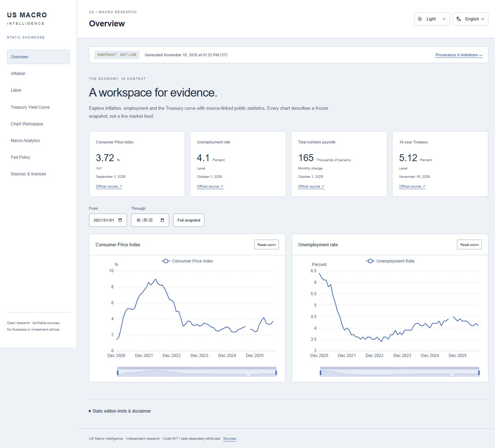
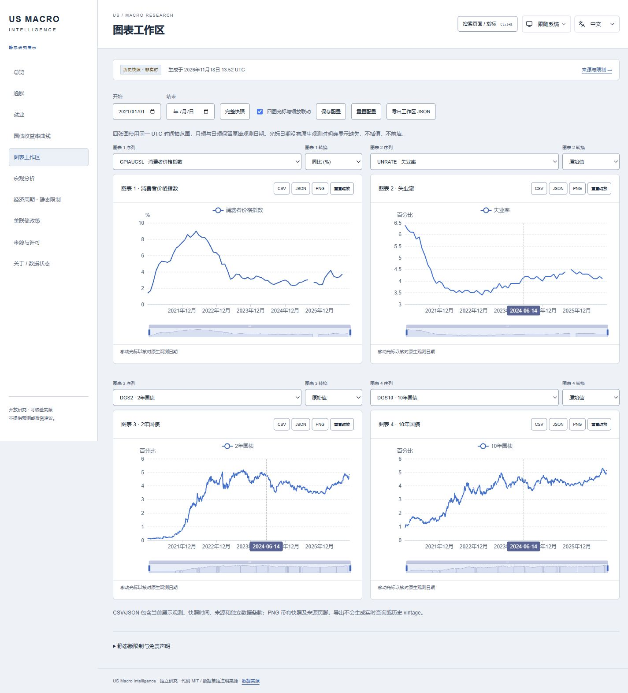
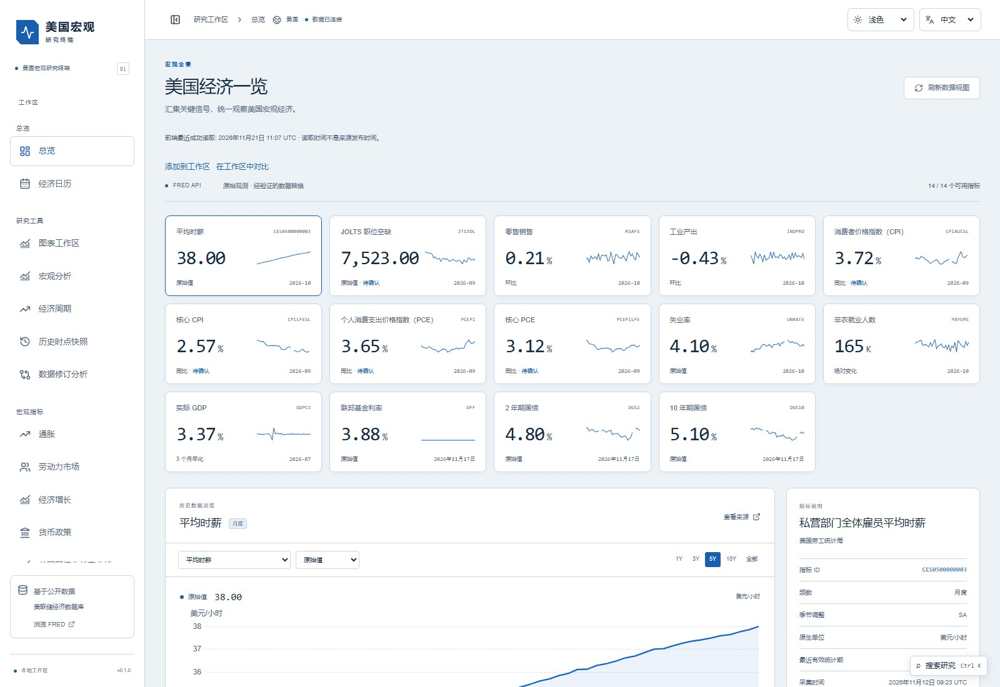
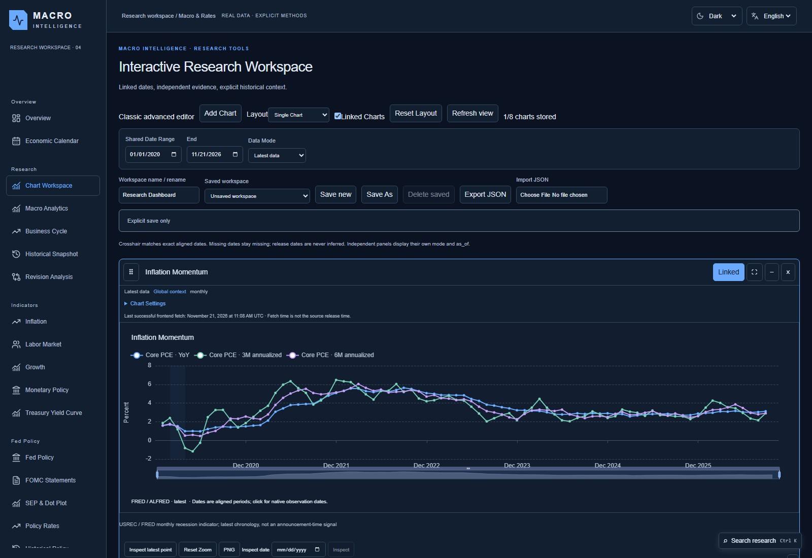

# US Macro Intelligence

[简体中文](README.zh-CN.md) · [Deployment](docs/DEPLOYMENT.md) · [Data permissions](docs/DATA_LICENSES.md)

An independent US macroeconomic research terminal and a self-contained static showcase. Explore official observations, inspect transformations and compare the Treasury curve while preserving clear observation dates, source attribution and missing values.

**Public Preview** · [Online demo](https://us-macro-intelligence.pages.dev/) · [GitHub CI](https://github.com/Issac0797/us-macro-intelligence/actions/runs/44430086339). The static website uses Cloudflare Pages Git Integration; no live backend is hosted. See [release status](docs/ITERATION9_PUBLIC_RELEASE.md) for actual verification results.

## Static showcase




## Full local terminal

Actual screenshots captured on **November 21, 2026 (Asia/Shanghai)** after restarting the local Next.js frontend, FastAPI backend and PostgreSQL database. These views use the local FRED/ALFRED data and are separate from the hosted static demo. Capture time and frontend fetch time do not imply that source observations were released or refreshed that day. Run the terminal locally with your own API key for API features; see the setup instructions below.

**Chinese overview · light theme.** Indicator cards, economic calendar navigation, source attribution and historical observations.



**English chart workspace · dark theme.** Core PCE year-over-year and annualized momentum, with a shared date range and chart controls. The capture uses a fresh browser session and an unsaved workspace.



## Choose how to use it

| Mode | Your own FRED API key? | Data and capabilities |
| --- | --- | --- |
| [Online demo](https://us-macro-intelligence.pages.dev/) or self-hosted static showcase | No | Reviewed historical snapshots, charts, search and exports; no live refresh |
| Full local terminal with `fred_csv` (default) | No | Downloads supported ordinary observations from FRED's public CSV service; limited metadata and revision research |
| Full local terminal with `fred_api` | **Yes** | FRED API observations and metadata, plus ALFRED vintage/revision research, subject to source availability |

**Bring your own key for API mode.** The maintainer's personal credentials are not included or shared. Apply for a key under your own FRED account and keep it in your local backend configuration. The public demo has no key-entry form; adding a key to Cloudflare Pages will not enable full-terminal features.

## Research goals and features

- The terminal's grouped navigation, selectable indicator cards, historical explorer, series brief, and observation ledger.
- Overview, inflation, labor, and Treasury term structure with dated curve comparison.
- Linked ECharts cursor/zoom, date filters, native units, CPI YoY/MoM, and absolute changes.
- Four-panel UTC-aligned workspace, browser-only configuration persistence, CSV/JSON/PNG export and Ctrl+K search.
- Descriptive exact-date Pearson correlation; no interpolation or synthetic observations.
- Selected verified historical Fed decisions with direct official citations.
- English / Simplified Chinese; light / dark / system appearance.
- Full local terminal: PostgreSQL observations and revisions, release monitoring, ALFRED research, chart workspaces, macro analytics and Fed research. Static limitations are labeled in the UI.

No forecasting models or trading features are included in this release.

## Architecture

```text
Windows full terminal: Next.js / React / ECharts → FastAPI → PostgreSQL
Static showcase:       Next.js static export → HTML + JS + reviewed JSON
Data refresh (manual): original-agency sources → whitelist/schema → snapshot PR
Automatic deployment:    GitHub main → Cloudflare Pages Git Integration
```

The separate `showcase/` entry reuses the terminal shell, grouped navigation, indicator cards, theme, and bilingual preferences through `scripts/release/sync-shared.mjs`. The public explorer reads the reviewed snapshot in the browser and can carry its series, time range, and transformation into Chart Workspace. Each public route exports a physical `index.html` with a dedicated `404.html` for unknown routes.

## Quick start: static showcase

Prerequisite: Node.js **24 LTS**, npm and Git. No Python, database or credentials are required to build the website.

```sh
git clone https://github.com/Issac0797/us-macro-intelligence.git
cd us-macro-intelligence
npm run build:showcase
```

This installs the locked showcase dependencies, exports the site into `showcase/out` and validates routes, links, licenses and sensitive-information patterns. To serve locally:

```sh
npx --yes http-server@14.1.1 showcase/out -a 127.0.0.1 -p 3100
```

Visit [the local preview](http://127.0.0.1:3100). On Windows PowerShell use `npm.cmd` / `npx.cmd` if script execution policy blocks the `.ps1` shims. To develop, run `npm ci --prefix showcase`, then `npm run dev --prefix showcase`.

## Full local terminal on Windows

Prerequisites: Git and Docker Desktop running Linux containers. Clone the repository as above, then run the following from its root. Keep an existing `.env`; never overwrite it.

```powershell
Copy-Item .env.example .env   # only if .env does not already exist
```

Edit `.env` and replace `POSTGRES_PASSWORD` with a unique local database password. Docker Compose supplies the container database connection. For native development, also update `DATABASE_URL` as described in [LOCAL_DEVELOPMENT](docs/LOCAL_DEVELOPMENT.md).

### Configure your data provider

To start without an API key, keep these defaults:

```dotenv
DATA_PROVIDER=fred_csv
FRED_API_KEY=
```

For full API metadata and ALFRED research:

1. Sign in to your own FRED account and request a key using the [official FRED API key instructions](https://fred.stlouisfed.org/docs/api/api_key.html).
2. Edit the existing entries in your local `.env`:

   ```dotenv
   DATA_PROVIDER=fred_api
   FRED_API_KEY=your_key_here
   ```

   Replace the placeholder with your actual key. A database password and a FRED API key are separate credentials.

### Start the terminal

After choosing either provider, start the services and download data:

```powershell
docker compose up --build -d --wait
docker compose exec -T backend python -m app.sync --full
```

Open [the terminal](http://localhost:3000) or [API documentation](http://localhost:8000/docs). `fred_csv` is an explicit alternative for supported ordinary observations; full ALFRED/metadata features require your own API access. The key stays in the backend. Database storage is a named volume; routine `docker compose down` preserves it.

For native Python/Node development and test commands see [LOCAL_DEVELOPMENT](docs/LOCAL_DEVELOPMENT.md). Portable paths are derived from the checkout, and no installed runtime, database or personal workspace is bundled.

### Credentials and troubleshooting

- `.env` is ignored by Git. Commit only the blank/example configuration in `.env.example`; keep real keys out of frontend code, `NEXT_PUBLIC_*` variables, screenshots, issues and static hosting settings.
- If you see `FRED_API_KEY is required for fred_api`, provide your own key or explicitly switch to `DATA_PROVIDER=fred_csv`. API mode requires a key and does not silently fall back to CSV.
- After changing `.env`, run `docker compose up --build -d --wait` again so the backend container picks up the new environment, then rerun the sync command. For a native process, restart the backend.
- For rejected keys or rate limits, check your FRED account, key and applicable [API terms](https://fred.stlouisfed.org/docs/api/terms_of_use.html). A key does not guarantee availability of every series or historical vintage.
- If a key is exposed, revoke/replace it through FRED and update your local `.env`; deleting it from the latest commit alone does not secure it. See [SECURITY](SECURITY.md).

## Data sources and rights

The public showcase includes only the 13 reviewed aliases in [data/licenses.json](data/licenses.json): CPI, core CPI, unemployment and payroll observations from **BLS**, plus federal funds and eight nominal Treasury maturities from **Federal Reserve Board H.15**. They are downloaded directly from the original agencies. Familiar FRED IDs are aliases, not a claim that a FRED/ALFRED dataset is redistributed.

Each snapshot records series/native IDs, units, frequency, seasonal adjustment, actual observation dates, generation time, coverage, attribution, permission references and original download checksums. Monthly dates identify statistical months, not release timestamps. Missing values remain null. Latest source revisions are not historical vintages. The UI always labels data **SNAPSHOT · NOT LIVE**.

The MIT license covers original project code and documentation. **Agency data, test source extracts, trademarks, and third-party software retain their own terms. They are not relicensed under MIT.** BLS statistics and the selected Board material were reviewed against [BLS copyright policy](https://www.bls.gov/bls/linksite.htm) and the [Board disclaimer](https://www.federalreserve.gov/disclaimer.htm). No agency seals, logos, photographs or external illustrations are distributed. See [DATA_LICENSES](docs/DATA_LICENSES.md), [DEPENDENCIES](docs/DEPENDENCIES.md) and [THIRD_PARTY_NOTICES](THIRD_PARTY_NOTICES.txt).

## Limits and validation

Static mode has no live updates, release calendar monitor, ALFRED revisions, server workspace account, database writes, custom source imports, complete FOMC chronology or SEP/Dot Plot. PCE, GDP, NBER and every unreviewed series are excluded from public snapshots. Browser storage is local to an origin and can be cleared. Correlation describes matched observations and does not establish causality.

CI retains all frontend/backend tests, TypeScript checks for both apps, PostgreSQL isolated-schema tests, snapshot JSON Schema and permission checks, source/artifact scans, static build, and route/link HTTP tests. The workflow performs no publishing. Cloudflare builds only committed safe assets and updates production from `main` after successful builds. See [ACCEPTANCE](docs/ACCEPTANCE.md) for actual results and untested cloud checks.

## Contributing and security

Use pull requests; see [CONTRIBUTING](CONTRIBUTING.md). Report vulnerabilities privately under [SECURITY](SECURITY.md); never post keys, connection strings or personal data in issues.

## Disclaimer

Independent research software, provided without warranty or agency endorsement. Data may be delayed, incomplete or revised. Nothing here is investment, trading, legal or tax advice. Verify source documents and applicable data terms before reuse.
