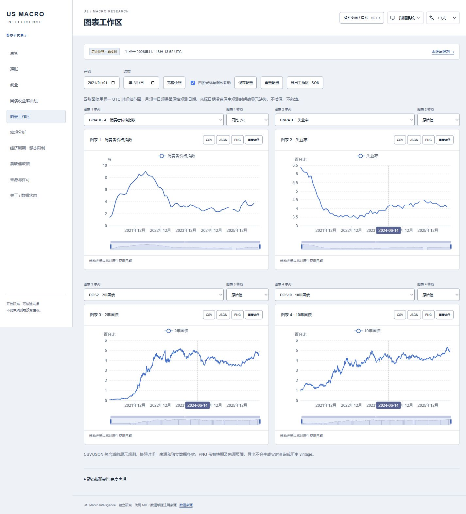

# US Macro Intelligence

[English](README.md) · [免费部署教程](docs/DEPLOYMENT.md) · [数据许可](docs/DATA_LICENSES.md)

独立的美国宏观经济研究终端，以及无需后端的静态展示版。项目以官方真实观测、明确的数据口径、可追溯来源和保留缺失值为基础，支持通胀、就业、国债曲线与政策历史研究。

**v0.1.0 Public Preview 源码发布。在线体验：尚未部署。** 静态网站随后通过 Cloudflare Pages Git Integration 单独部署，不托管实时后端；实际状态见 [发布报告](docs/ITERATION9_PUBLIC_RELEASE.md)。




## 功能与研究目标

- 总览、通胀、就业、国债收益率曲线及指定日期比较。
- 图表联动光标与缩放、日期筛选、原生单位、同比/环比/绝对变化。
- 四图 UTC 时间对齐、浏览器保存研究配置、CSV/JSON/PNG 导出及 Ctrl+K 搜索。
- 按完全匹配日期计算描述性皮尔逊相关系数，不插值、不生成人造观测。
- 选定且已核验的美联储历史决策，提供官方原文链接。
- 简体中文 / English；浅色 / 深色 / 跟随系统。
- 本地完整版保留 PostgreSQL 观测与修订、经济日历监控、ALFRED、图表工作区、宏观分析和 Fed Policy。

本轮不新增预测模型或交易功能。

## 技术架构

```text
Windows 完整版：Next.js / React / ECharts → FastAPI → PostgreSQL
静态展示：      Next.js Static Export → HTML / JS / 已审核 JSON
快照更新：      官方原始来源 → 许可白名单及 Schema → PR
后续自动部署：  GitHub main → Cloudflare Pages Git Integration
```

独立 `showcase/` 入口通过 `sync-shared.mjs` 复用原终端主题、国际化、展示 Provider 与偏好组件。静态版没有 API 代理、服务器 Cookie 请求、数据库访问或后台任务；不会请求本机 API。每条公开路由生成真实 `index.html`，并保留独立 `404.html`。

## 静态版本地启动

需要 Node.js **24 LTS**、npm 和 Git；构建不需要 Python、PostgreSQL 或 API Key。

```powershell
npm.cmd run build:showcase
npx.cmd --yes http-server@14.1.1 showcase/out -a 127.0.0.1 -p 3100
```

访问 [本地展示](http://127.0.0.1:3100)。构建命令会按 lockfile 安装静态依赖，输出 `showcase/out`，并检查路由、链接与产物敏感信息。开发使用 `npm.cmd ci --prefix showcase` 后运行 `npm.cmd run dev --prefix showcase`。

## Windows 本地完整研究终端

推荐 Docker Desktop（Linux containers）。已有 `.env` 时不要覆盖。

```powershell
Copy-Item .env.example .env   # 仅在不存在时执行
# 在 .env 中填写独立本地数据库口令。
# 如需完整 API 元数据及 vintage 能力，填写自己的 FRED_API_KEY，设置 DATA_PROVIDER=fred_api。
docker compose up --build -d --wait
docker compose exec -T backend python -m app.sync --full
```

访问 [研究终端](http://localhost:3000) 或 [API 文档](http://localhost:8000/docs)。`fred_csv` 是普通观测的显式替代路径，不能替代所有 ALFRED 与元数据功能。密钥只供后端读取。普通 `docker compose down` 保留命名数据卷。原生开发与完整测试步骤见 [LOCAL_DEVELOPMENT](docs/LOCAL_DEVELOPMENT.md)。

## 数据来源、使用与版权

公开快照仅纳入 [许可白名单](data/licenses.json) 中 13 个已审核系列：BLS 的 CPI、核心 CPI、失业率、非农就业，以及美联储 Board H.15 的有效联邦基金利率和八个名义国债期限。数据直接取自原始机构，FRED Series ID 仅作为熟悉的别名，不再分发 FRED/ALFRED 数据集。

快照包含 Series ID / 原生编号、真实观测日期、值、单位、频率、季调、来源、生成日期、覆盖范围、许可说明及下载校验值。月度日期代表统计月份，不是发布时间；缺失值保留为空；最新修订后的观测不冒充历史 vintage。所有页面显式标为“历史快照 · 非实时”。

**MIT 仅适用于原创项目代码和文档，不自动覆盖政府数据、测试来源摘录、商标或依赖软件。** 数据按 [BLS 政策](https://www.bls.gov/bls/linksite.htm) 和 [美联储 Board 声明](https://www.federalreserve.gov/disclaimer.htm) 核查并保留来源；不分发官方徽章、标志、照片或外部插图。详见 [数据许可说明](docs/DATA_LICENSES.md)、[依赖许可说明](docs/DEPENDENCIES.md) 和 [第三方许可原文](THIRD_PARTY_NOTICES.txt)。

## 已知限制与验证

静态版不提供实时更新、经济日历监控、ALFRED 修订、服务器研究账户、数据库写入、自定义来源导入、完整 FOMC 年表或 SEP/点阵图。PCE、GDP、NBER 及所有未审核系列被排除。浏览器配置只在当前来源内保存，可能被浏览器清除。相关性是描述性统计，不代表因果。

CI 保留原前后端全部测试，加入双项目 TypeScript、PostgreSQL 隔离 schema、快照 Schema/许可、源码/产物扫描、静态构建及 HTTP 链接路由检查。CI 不执行发布；后续通过 Cloudflare Git Integration 在 `main` 成功构建后更新正式站。实际结果与未完成的云端检查见 [验收表](docs/ACCEPTANCE.md)。

## 参与与安全

通过 PR 贡献，遵守 [CONTRIBUTING](CONTRIBUTING.md)。安全问题按 [SECURITY](SECURITY.md) 私下报告，不在公开 issue 粘贴密钥、数据库连接或个人研究资料。

## 免责声明

本项目是独立研究软件，不作任何担保，也不代表数据机构背书。数据可能延迟、缺失或修订，不构成投资、交易、法律或税务建议。使用前应再次核对官方来源及适用条款。
